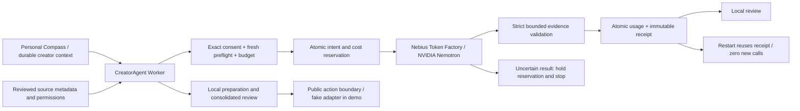

# CreatorAgent architecture

The local Python worker uses SQLite for dependency tasks, durable context, scoped approvals, attempts, artifacts and events. Personal Compass describes the existing CreatorContext: purpose and priorities are retained with identity, voice, source scope and boundaries. It is not a separate autonomous-life-memory service.

The two graphs share Worker/Store, with scoped authorizer/executor hooks for synthetic_evidence_audit → local_review. The public launch demo remains deterministic and fake-publication only. The dedicated runtime adapter is disabled by default. One earlier approved real synthetic fact audit passed through the actual worker; it is not connected as a generally validated production creator workflow.

Trusted metadata owns source identity, speaker, personal-report status, epistemic status and permissions. The model's protected fields are consistency checks; they cannot rewrite provenance, authorize spending or publish. Subjective experience remains attributed experience, not independent truth. Unknown/stale annotations require review.

Exact payload and context hashes, task generation, consent and fresh provider checks bind at the intent/reservation transaction. A conservative $0.00072 reserve fitted the $0.001 one-call cap. Successful strict validation, usage settlement and receipt commit together. Before-commit uncertainty cannot redeliver; after-commit restart reuses the receipt. This is at-most-once intent, not exactly-once HTTP assurance.

LIVE_NEBIUS denotes an actual client-observed dedicated-adapter result; RECORDED denotes historical evidence; MOCK denotes manufactured offline responses. The October 10 runtime response passed exact_match, 632 input / 383 completion tokens, $0.00012984 API-derived credits. Post-V8 billing reconciled; post-runtime billing is pending. Raw provider reasoning stays private. Public projections are explicitly subsets, not original envelopes.

Diagram narration: context and reviewed provenance feed the worker; consent and budget precede the NVIDIA call; validation and durable receipt precede local review; restart reads the receipt; uncertainty stops. The public-action branch is independent and remains gated.
