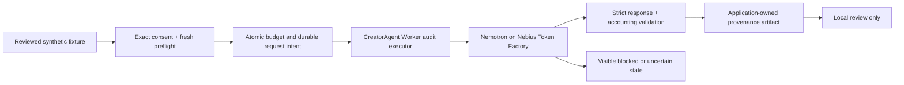

**Status update October 10:** the actual worker-runtime fact validation passed; post-V8 billing reconciled, post-runtime billing remains pending. See RUNTIME_PROOF.md and READINESS.md for current status. The earlier plan/rule-snapshot text below is retained for context, not current runtime readiness. No full production audit or final submission compliance is claimed.

# Original runtime plan — implementation update below

Local worker integration is now implemented and tested. Live transport remains disabled; runtime compliance has not been demonstrated. See COMPETITION_RUNTIME_IMPLEMENTATION.md for the current implementation and limits.

# Minimal competition runtime design — defined, not yet implemented

The official [rules](https://nebiusglobalaihackathon.devpost.com/rules) and [FAQ](https://nebiusglobalaihackathon.devpost.com/details/faqs) define the platform condition: the application can call Token Factory at runtime while its other components stay local. Organizer clarification is not a prerequisite to designing that path. Compliance is not claimed: today's submission build has recorded evidence but no connected live worker operation.

## Smallest honest implementation

Add one `synthetic_evidence_audit` task to the CreatorAgent workflow, preceding a local review artifact. The actual Worker must schedule and execute it through a dedicated executor adapter; a standalone evaluator or a playback panel alone does not meet this design. It sends one approved synthetic fact-extraction request, validates the response, persists a provenance-bound artifact, and continues only to local preparation/review. Public execution remains blocked by application policy.

Reuse the exact saved V8 `fact-1` request: same model, prompt, four fictional source statements, task, parameters and 2,000-token completion/reasoning limit. The answer is a count from fictional source s1. No new open-ended interpretation, experience classification, voice inference or promotion generation is delegated. No new six-case audit is proposed. V8's successful fact gate is supporting historical evidence, not a guarantee of the new request.

## Application/model responsibilities

The app binds source identity and hash, speaker, personal-report flag, epistemic status, permissions and local action routing from reviewed metadata. For this s1 fact: speaker/attribution are null, personal_report=false, epistemic status is a statement in a fictional source, not independently verified real-world fact. Nemotron extracts the bounded answer and citations. Existing model label/attribution/action fields are untrusted consistency checks, never sources of authority; mismatches stop the task instead of overriding app metadata. No unsupported sales demand is inferred.

Preserve the returned content unchanged. Apply existing fact-only terminal punctuation/whitespace comparison solely for acceptance; record exact versus surface-equivalent separately. References, protected fields, numbers, units and substantive wording remain strict. Duplicate keys, extra fields, truncation, wrong identity and inconsistent usage fail closed. A local test specification covers this boundary but is not a production validator integration.

## Implementation map — no changes executed yet

1. Add a versioned synthetic runtime fixture/task definition and app-owned metadata compiler. Pin the saved request/hash rather than collecting text from arbitrary project files. The compiler validates current reviewed source bytes before dispatch.
2. Extend operation allowlisting and policy for `synthetic_evidence_audit`. Bind proposal hash, context revision, exact sources, one request and budget to explicit approval. Preparation may continue locally; the cloud step waits for consent/preflight. Public permission remains false.
3. Add `competition_runtime.py` executor integration with the existing Worker injection point. Reuse CloudDispatch for atomic consent/context/budget intent and NebiusHTTP for exact-host/no-redirect/no-retry transport. Default transport remains disabled. Only an explicitly approved runtime command enables this scoped step.
4. Before making any new intent, examine prior request/artifact state. Reuse a validated persisted result on restart; never redeliver its request. An unresolved committed intent blocks. Wrap provider/unavailable/accounting failures as a blocked/uncertain condition so the Worker's generic scheduled-retry behavior cannot issue another call. A task attempt limit alone is insufficient crash protection. The display never substitutes local fixture output for NVIDIA success.
5. Persist response evidence and accounting before task completion. Reuse atomic settlement where possible. Close the current gap between engine settlement and artifact persistence: store an append-only response envelope/diagnostic and request linkage in the same settlement transaction, or journal raw bytes with hash before committing settlement. Crash after receipt but before durable proof stays uncertain; crash after atomic settlement recovers the existing artifact with no extra request. Do not assert exactly-once HTTP delivery after unknown outcomes.
6. Add a runtime receipt panel: task/attempt, UTC time, exact endpoint/model, request hash, provider response ID or public-safe hash, raw-content hash, provider usage, API-derived cost, validation policy/result, and explicit LIVE_NEBIUS versus RECORDED versus MOCK mode. Only the real HTTP adapter can originate the live receipt; caller-supplied flags cannot upgrade mock/replay evidence. These are client-observed records, not provider-signed attestation. Official dashboard reconciliation remains a separate evidence level.

Keep V1–V8, their validators and recorded outcomes immutable. New local integration code/tests and future results have their own versioned artifacts. Do not modify the current submission candidate into a connected path during this planning stage.

## Proposed live validation — one request, not another model-tuning loop

See `Proposed Live Scope.json` for the exact payload and hash. Model: `nvidia/NVIDIA-Nemotron-3-Nano-30B-A3B`; base URL: `https://api.tokenfactory.nebius.com/v1/`. Data is the exact original four fictional source statements plus fixed system instructions/options/question; all are public-safe. Four sources remain in the unchanged accepted payload even though the answer cites only s1.

One inference request; no repair or retry. Maximum input 4,000 tokens; maximum billed visible output plus reasoning 2,000 tokens. Historical template count for this exact request was 632, but fresh model/template token bounds must still pass. At the recorded rates of $0.06/M input and $0.24/M completion, conservative token reservation is $0.00072. Proposed additional hard credit ceiling: **$0.001; $0 out-of-pocket**. Changed rates or accounting stop for review rather than consuming headroom. At most one authenticated GET /models may confirm availability; it is metadata, not a second inference. No model-list request is made now.

This is a separately proposed stage, not reuse of the final old-stage slot. The old stage stays closed at 23 calls/$0.00364890 with its last request unused. A new ledger/group must carry forward historical cost/provenance in its aggregate report and explicitly identify new consent, count and cap; it must not reset or pretend past usage vanished. The hypothetical token maximum across both stages is $0.00436890. No additional spending is approved by this document.

Fresh preflight before any future call must confirm authenticated model identity, exact rates/endpoint, ZDR, token/reasoning semantics, credit balance and no out-of-pocket path, and post-V8 official reconciliation. `store:false` does not establish ZDR; an application reservation does not prove the provider cannot charge a card. Reject expired or incomplete evidence. Current readiness remains blocked on the previously observed billing gap until a fresh recheck passes.

The single future run must execute **inside CreatorAgent**, persist a validated result and visibly continue to the local review. Restart must reuse that result without a second call. Capture the runtime screen during this same validation if desired; no separate recording call is budgeted. If filming later, label the receipt as an earlier recorded runtime result, never a newly performed live call.

## Judge access and publication

Ship the functional optional runtime path, exact synthetic fixture, consent/budget instructions and recorded proof with the public test build after approval. Key-free replay can support inspection but is labeled replay. Free judge access to the actual runtime path requires a separately approved bounded credential/service arrangement; do not expose the creator's key or require judges to fund calls. A judge-scoped funded endpoint/grant could address this, but its hosting, lifetime, allowances and credentials are **not** part of this one-request proposal. This remains a submission-access planning gate, not a reason to host the whole app on AI Cloud.

After local integration and the separately approved one-call validation succeed, report only: CreatorAgent made a runtime NVIDIA fact-audit call through Token Factory and validated that result. Do not claim broad reasoning reliability, the six-case audit passed, a production worker, whole-book analysis or autonomous public execution. No publishing/contact action is required for local validation.
